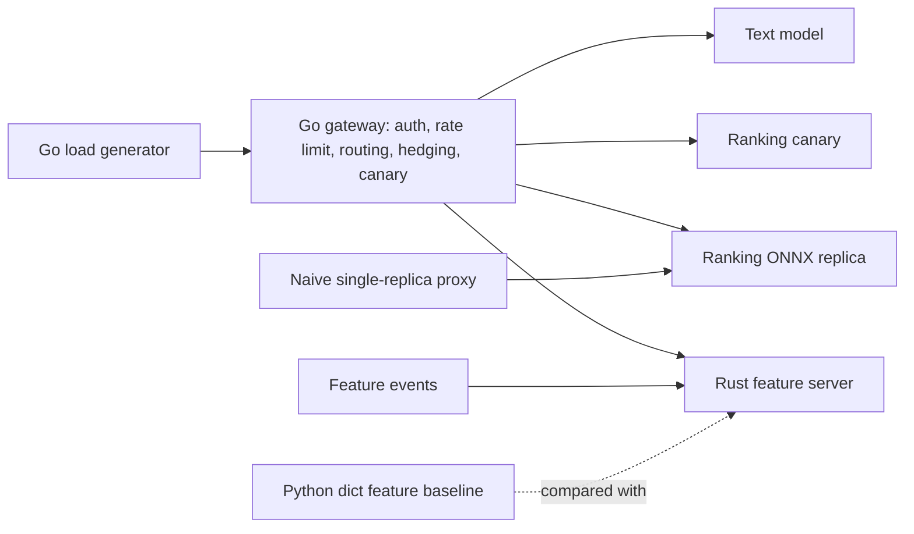

# Disaggregated model serving on kind

A small disaggregated serving stack for ranking MovieLens ratings: a Go gateway, a Rust online feature server, and Python ONNX Runtime model pods. `python run.py` trains the models, builds images, creates a single-node kind cluster named `mlserve`, runs fault scenarios, writes `results/metrics.json` from the request logs, and deletes the cluster. Traffic is generated. Nothing here is a production deployment.

## Setup

Python 3.12, Go 1.27, Rust 1.99, Docker, kind, and kubectl are required. The default command uses a local kind cluster. Docker's Linux engine must already be running (`docker info` succeeds); `python run.py` does not start Docker Desktop, WSL, or Windows services.

```text
python -m venv .venv
.venv\Scripts\pip install -r requirements.txt
python run.py
```

`python run.py --local` keeps every replica as a process on this machine. `python run.py --quick` implies `--local` and uses a small request count so it can finish in a few minutes once the Go and Rust binaries exist. `--skip-build` reuses binaries that are already present in local mode.

## Architecture



Kubernetes manifests and a kind config live in `k8s/`. The default command creates cluster `mlserve`, loads the local images, installs metrics-server with `--kubelet-insecure-tls`, and tears the cluster down at the end. `results/k8s_events_*.csv` records harness actions and rows read back from the API server (`source` is `harness` or `kubectl`).

## Design decisions

The ranking model is a scikit-learn MLP on user and item aggregates fit only on the earlier MovieLens ratings. A later time slice is the test set. It is scored once and is not used to choose the architecture or the fault thresholds. The network is exported as a float64 ONNX graph so serving can be compared with the training framework on that same slice.

The gateway keeps a short feature cache, picks the lower latency replica, hedges when the first replica is slow, and retries with jittered backoff. A canary with a high injected error rate is removed when its recent error rate crosses 0.4. The naive proxy forwards to one replica and does none of that. The Python baseline is a locked dict behind a threaded HTTP server, which is what the Rust lookup latency is compared with.

The 5x spike is an injected service delay: 16 ms on a healthy replica and 80 ms on the replica the naive proxy uses. Pod kills are `kubectl delete pod` against one ranking replica. The canary deployment starts at weight 0.10 and answers half of its requests with HTTP 500 until the gateway rolls that weight back. The HPA scenario watches the API server until a second ranking pod is Ready.

## Dataset

MovieLens 100K from GroupLens: https://grouplens.org/datasets/movielens/100k/

The file `ml-100k.zip` is checked with MD5 `0e33842e24a9c977be4e0107933c0723` and the ratings file must contain 100,000 rows. The GroupLens license allows non-commercial research use with citation. Request workloads are generated locally from the held-out rows.

## Results

Generated from `results/metrics.json` by `python run.py`.

<!-- RESULTS_START -->
| Criterion | Value | Op | Threshold | Passed |
| --- | --- | --- | --- | --- |
| Success rate when one model pod is killed every 30 s under load | 1 | >= | 0.995 | True |
| p99 latency under a 5x latency spike on one replica is at least 40% lower than the naive proxy | 0.775146 | >= | 0.4 | True |
| p95 gateway overhead without faults | 0.692475 | < | 5.0 | True |
| Rust feature server p99 lookup latency at 2,000 RPS | 1.25134 | < | 2.0 | True |
| Rust feature server at least 3x faster than a Python feature-lookup baseline | 13.0526 | >= | 3.0 | True |
| HPA scale-out reaction time in seconds from load step to added ready replica | 25.335 | between | 0.01 to 120.0 | True |
| Canary rollback within 60 s | 46.325 | <= | 60.0 | True |
| Canary failed fraction | 0.0057 | < | 0.01 | True |
| ONNX serving parity | 1.77636e-15 | < | 1e-05 | True |
| Unauthorized or out-of-scope requests rejected | 1 | >= | 1.0 | True |
| Go test coverage | 0.849 | >= | 0.75 | True |
| Python test coverage | 0.819648 | >= | 0.8 | True |
| Rust tests for every public function | 1 | >= | 1.0 | True |

| Metric | Value |
| --- | --- |
| success_rate_podkill | 1 |
| success_rate_podkill_naive | 0.913091 |
| p99_spike_ms | 18.6002 |
| p99_spike_naive_ms | 82.7212 |
| p95_overhead_ms | 0.692475 |
| fs_p99_ms | 1.25134 |
| fs_python_p99_ms | 16.3333 |
| hpa_reaction_s | 25.335 |
| canary_rollback_s | 46.325 |
| canary_failed_frac | 0.0057 |
| onnx_max_abs_diff | 1.77636e-15 |
| auth_reject_rate | 1 |
<!-- RESULTS_END -->

Plots: `results/latency_podkill.png`, `results/latency_spike.png`, `results/success_podkill.png`.

## Limitations

The cluster is one kind node with a ~4 GB Docker VM, so the load generator offers less traffic than a production gateway would. HPA reaction time includes metrics-server scrape delay and image startup, and it moves a little from run to run. Redpanda is deployed with `--smp 1` and `--memory 512M`; if it does not become ready the runner deletes that deployment and keeps the HTTP feature ingest, which is what the Rust and Python servers actually serve. The text model is a ridge regression on hashed movie titles, used to exercise a second ONNX service and the server-sent-event route. Peak memory is the Python process tree only; the Docker VM is separate and is not counted in `hardware.peak_rss_gb`.
