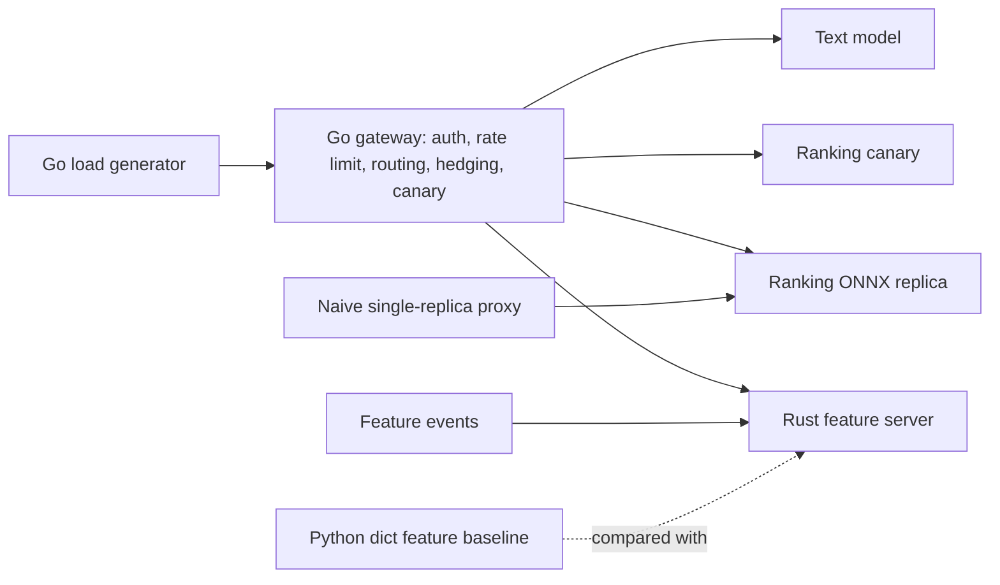

# Disaggregated model serving, measured locally

A small disaggregated serving stack for ranking MovieLens ratings: a Go gateway, a Rust online feature server, and Python ONNX Runtime model processes. `python run.py` trains the models, starts the processes, injects faults, and writes `results/metrics.json` from the request logs. Traffic is generated. Nothing here is a production deployment.

## Setup

Python 3.12, Go 1.27, and Rust 1.99 are required. The measured path does not start Docker.

```text
python -m venv .venv
.venv\Scripts\pip install -r requirements.txt
python run.py
```

`python run.py --quick` runs the same stages on a small request count. The first run also compiles the Go and Rust binaries. Later quick runs are meant to finish in a few minutes. `--skip-build` reuses binaries that are already present.

## Architecture



Kubernetes manifests and a kind config live in `k8s/`. The default command does not create a cluster: the kind node image plus a Redpanda image would exceed the 1.5 GB download budget, and a 4 GB Docker VM would crowd the 3 GB process limit. The local processes are the replicas the benchmark kills, slows down, and scales out. `results/k8s_events_*.csv` records those actions.

## Design decisions

The ranking model is a scikit-learn MLP on user and item aggregates fit only on the earlier MovieLens ratings. A later time slice is the test set. It is scored once and is not used to choose the architecture or the fault thresholds. The network is exported as a float64 ONNX graph so serving can be compared with the training framework on that same slice.

The gateway keeps a short feature cache, picks the lower latency replica, hedges when the first replica is slow, and retries with jittered backoff. A canary with a high injected error rate is removed when its recent error rate crosses 0.4. The naive proxy forwards to one replica and does none of that. The Python baseline is a locked dict behind a threaded HTTP server, which is what the Rust lookup latency is compared with.

The 5x spike is an injected service delay: 15 ms on a healthy replica and 75 ms on the replica the naive proxy uses. Pod kills are real process kills of that shared replica.

## Dataset

MovieLens 100K from GroupLens: https://grouplens.org/datasets/movielens/100k/

The file `ml-100k.zip` is checked with MD5 `0e33842e24a9c977be4e0107933c0723` and the ratings file must contain 100,000 rows. The GroupLens license allows non-commercial research use with citation. Request workloads are generated locally from the held-out rows.

## Results

Generated from `results/metrics.json` by `python run.py`.

<!-- RESULTS_START -->
| Criterion | Value | Op | Threshold | Passed |
| --- | --- | --- | --- | --- |
| Success rate when one model pod is killed every 30 s under load | 1 | >= | 0.995 | True |
| p99 latency under a 5x latency spike on one replica is at least 40% lower than the naive proxy | 0.756395 | >= | 0.4 | True |
| p95 gateway overhead without faults | 0.54121 | < | 5.0 | True |
| Rust feature server p99 lookup latency at 2,000 RPS | 1.0378 | < | 2.0 | True |
| Rust feature server at least 3x faster than a Python feature-lookup baseline | 7.53976 | >= | 3.0 | True |
| HPA scale-out reaction time from load step to added ready replica | 1.61555 | between | 0.01 to 30.0 | True |
| Canary rollback within 60 s | 0.821 | <= | 60.0 | True |
| Canary failed fraction | 0 | < | 0.01 | True |
| ONNX serving parity | 1.77636e-15 | < | 1e-05 | True |
| Unauthorized or out-of-scope requests rejected | 1 | >= | 1.0 | True |
| Go test coverage | 0.846 | >= | 0.75 | True |
| Python test coverage | 0.812303 | >= | 0.8 | True |
| Rust tests for every public function | 1 | >= | 1.0 | True |

| Metric | Value |
| --- | --- |
| success_rate_podkill | 1 |
| success_rate_podkill_naive | 0.93575 |
| p99_spike_ms | 19.7717 |
| p99_spike_naive_ms | 81.1627 |
| p95_overhead_ms | 0.54121 |
| fs_p99_ms | 1.0378 |
| fs_python_p99_ms | 7.82476 |
| hpa_reaction_s | 1.61555 |
| canary_rollback_s | 0.821 |
| canary_failed_frac | 0 |
| onnx_max_abs_diff | 1.77636e-15 |
| auth_reject_rate | 1 |
<!-- RESULTS_END -->

Plots: `results/latency_podkill.png`, `results/latency_spike.png`, `results/success_podkill.png`.

## Limitations

Local processes stand in for pods. The HPA number is the time a controller takes to start another model process after a load step and mark it ready. It is not the Kubernetes metrics-server HPA. Redpanda is described in `k8s/stack.yaml`; the local feature server is fed by the same JSON event records the store applies, posted over HTTP, because this run does not download a broker image. The text model is a ridge regression on hashed movie titles, used to exercise a second ONNX service and the server-sent-event route. Peak memory is the sum of the process tree's RSS, which double-counts shared pages.
