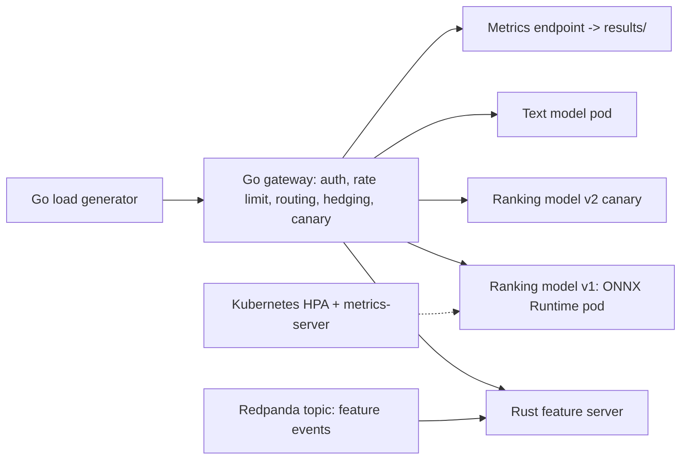

# Disaggregated Model-Serving Platform on Kubernetes - Go Gateway, Rust Feature Server, Dockerized ONNX Models, Autoscaling and Fault Injection

`ml-serving-platform` · new project · estimated build effort: 8 h

## Problem

ML serving platforms route prediction requests, fetch online features, and keep latency SLOs while models roll out and pods fail. This project builds a small disaggregated serving stack on a local Kubernetes (kind) cluster: a Go gateway (HTTP + server-sent-event streaming, API-key auth with per-model scopes, token-bucket rate limiting, latency-aware routing, retries with jittered backoff, circuit breakers, hedged requests, weighted canary rollout), a Rust online feature server (async, sharded in-memory store with TTL, fed by Kafka-compatible events from a Redpanda container), and Python model servers in Docker running ONNX Runtime (a LightGBM/MLP ranking model trained on a public dataset and a small text model). A Go load generator drives reproducible scenarios with injected faults (pod kills, latency spikes, 5xx bursts) and measures p50/p95/p99 latency, success rate, autoscaling reaction time and canary safety, against a naive single-backend proxy.

## Target jobs and skills

- **fal - Features & Labels — Software Engineer, Machine Learning-Backend** (`7248e09a94b1`): covers 85% of the JD's weighted top skills (Python, FastAPI, CI/CD, Git, Docker, MLOps, Model Monitoring)
- **Apple — Applied AI Engineer, Agent Harness** (`2d9909653024`): covers 21% of the JD's weighted top skills (Rust, Go, Python)
- **DoorDash — Software Engineer, ML Serving Platform** (`07ae89f28230`): covers 82% of the JD's weighted top skills (Python, Go, MLOps, Kubernetes, Docker, Model Monitoring, FastAPI)
- **Robinhood — Software Engineer, AI Security** (`e226762744b9`): covers 55% of the JD's weighted top skills (Python, Kubernetes, Kafka, Go, FastAPI)

Skills/tools this project demonstrates: Go, Rust, Python, Docker, Kubernetes, Kafka, MLOps, ONNX, FastAPI, CI/CD, Git, Model Monitoring, Machine Learning, Recommender Systems

## Data

- **Dataset:** MovieLens 100K (ranking model) plus generated request workloads — https://grouplens.org/datasets/movielens/100k/
- **License/terms:** GroupLens research license (non-commercial research use, attribution); workloads generated locally
- **Size used:** 100,000 ratings for training the ranking model; 20,000 to 50,000 requests per load scenario
- **Plan:** Ranking model trained offline on a time-based split and exported to ONNX; serving correctness checked by comparing ONNX outputs to the training framework on held-out rows. Load scenarios use fixed seeds and fault schedules so each one replays exactly.

## Architecture

## Tech stack

Go 1.27 (gateway, load generator), net/http, go test, Rust 1.99 (feature server), tokio, axum, cargo test, Python 3.11, ONNX Runtime, LightGBM or scikit-learn MLP, FastAPI model servers, Docker (slim images, total under 3 GB), Redpanda single-node container, Kubernetes via kind (single node), Deployments, Services, readiness/liveness probes, HPA, metrics-server, GitHub Actions CI (go test, cargo test, pytest, image builds)

## Deliverables

- gateway/ (Go) with unit tests for routing, circuit breaker, rate limiter, auth scopes, canary weights
- featureserver/ (Rust) with unit and concurrency tests
- models/ (training, ONNX export, parity check, FastAPI servers, Dockerfiles)
- k8s/ manifests and a kind config; run.py builds images, creates the cluster, deploys, runs scenarios and tears down
- loadgen/ (Go) and results tables/plots per scenario
- A no-cluster mode (local processes) so tests and a reduced benchmark run without Docker

## Success criteria (all must hold on a from-scratch `python run.py`)

| Metric | Threshold | How it is measured |
|---|---|---|
| Success rate when one model pod is killed every 30 s under load | >= 99.5% for the gateway, reported next to the naive proxy | kind cluster, 20,000 requests |
| p99 latency under a 5x latency spike on one replica | at least 40% lower than the naive proxy | hedging + latency-aware routing |
| p95 gateway overhead without faults | < 5 ms | gateway vs. direct-to-model timing on the same requests |
| Rust feature server p99 lookup latency at 2,000 RPS | < 2 ms, and at least 3x faster than a Python feature-lookup baseline | loadgen against both servers |
| HPA scale-out reaction time from load step to added ready replica | reported, with SLO attainment during the step | step-load scenario |
| Canary safety - a deliberately bad v2 (high error rate) is auto-rolled back | rollback within 60 s with < 1% of total requests failed | canary scenario |
| ONNX serving parity | max absolute difference < 1e-5 vs. the training framework on held-out rows | parity test |
| Unauthorized or out-of-scope requests rejected | 100% in the test matrix | go test |
| Test coverage | Go >= 75%, Python >= 80%; Rust tests for every public function | go test -cover, pytest --cov, cargo test |

## Evaluation artifacts (required; the evaluator recomputes metrics from these)

- results/metrics.json with keys success_rate_podkill, success_rate_podkill_naive, p99_spike_ms, p99_spike_naive_ms, p95_overhead_ms, fs_p99_ms, fs_python_p99_ms, hpa_reaction_s, canary_rollback_s, canary_failed_frac, onnx_max_abs_diff, auth_reject_rate, seeds, hardware
- results/loadtest_<scenario>.csv with one row per request (request_id, scenario, mode in {gateway, naive}, backend_final, attempts, status, latency_ms, ts)
- results/k8s_events_<scenario>.csv (ts, object, event) for pod kills, scale-outs and rollbacks

## Baseline

Naive pass-through proxy to a single model replica with no retries, hedging, circuit breaking or canary control; Python dict-based feature lookup service.

## Constraints

- Runs on Windows with `python run.py` from a fresh virtualenv; no make, shell scripts, paid APIs, or accounts.
- CPU-only by default (an optional `--device cuda` flag is fine); peak RAM <= 3 GB; total downloads <= 1.5 GB.
- PyTorch (if used) pinned to the CPU wheel via `--extra-index-url https://download.pytorch.org/whl/cpu`.
- Fixed random seeds; every reported number is written by code to results/metrics.json (never typed by hand).
- Test split is created once, saved, and never used for training, tuning, or threshold selection.
- Data download is scripted (Python requests), cached under data/, and verified by checksum or row count.
- Runs locally on 16 GB RAM - Docker WSL VM capped at 4 GB; single-node kind; small ONNX models.
- All traffic is generated; no claim of production use; no paid services or cloud accounts.

## Draft resume bullets (placeholders are filled only with reproduced metrics)

- Built a disaggregated model-serving stack on Kubernetes (kind) with a Go gateway, a Rust feature server and Dockerized ONNX models, keeping [SUCCESS]% of requests successful while pods were killed under load vs. [BASE_SUCCESS]% for a naive proxy
- Cut p99 latency by [P99_CUT]% during a simulated replica slowdown with hedged, latency-aware routing at under [OVERHEAD] ms p95 gateway overhead
- Wrote a Rust (tokio) online feature server fed by Kafka-compatible events with [FS_P99] ms p99 lookups at 2,000 RPS ([FS_SPEEDUP]x faster than a Python baseline), plus HPA autoscaling and automatic canary rollback

## Scope change (2026-10-12, overrides earlier sections; reviewer)

Iteration 1 ran every scenario as local processes (`execution_mode: local_processes`); the "pod kills", scale-outs and
canary rollbacks were process restarts, so the Kubernetes claims are not supported. Docker Desktop 29.8 is now running
with a 4 GB WSL VM cap, and kind v0.33 + kubectl v1.37 are installed. Required changes:

1. `python run.py` must create a single-node kind cluster (name `mlserve`), build the images and `kind load` them, deploy
   with the manifests in `k8s/`, run the scenarios against the cluster, and delete the cluster at the end (also on error).
   `metrics.json` must report `execution_mode: "kind"`. Keep the local-process mode only behind `--local` (used by tests).
2. Real Kubernetes events: pod kills via `kubectl delete pod` on a running replica; autoscaling via a real HPA
   (metrics-server installed in the cluster with `--kubelet-insecure-tls`); canary via the gateway's weights with real
   v1/v2 Deployments. Record `results/k8s_events_<scenario>.csv` with columns ts, object, event, source, where `source`
   is `kubectl` for events read from the API server (`kubectl get events` / pod status) and `harness` for actions you
   issued. HPA reaction time is measured from the load step to the new pod's Ready condition from the API server.
3. Memory: the Docker VM has 4 GB. Use slim images (python:3.12-slim + onnxruntime, distroless/static Go, Rust on
   debian-slim), resource requests/limits on every pod, at most 2 replicas per model by default (HPA max 4), and
   Redpanda with `--smp 1 --memory 512M --overprovisioned`. Total images under 2.5 GB. Disk is tight (about 8 GB free):
   prune only this project's own images at the end, never other images.
4. Keep the existing criteria and thresholds. Load tests may be shorter if needed (podkill at least 10,000 requests per
   mode, at least 5 kills). Report honestly if the cluster numbers miss a threshold.
5. Go tests (`go test ./... -cover`) and Rust tests (`cargo test`) must pass; the evaluator runs them too.
6. Every `results/loadtest_*.csv` row must have a non-empty `mode`: `gateway` | `naive` (podkill, spike), `gateway` |
   `direct` with the same `row_id` for each pair (overhead, at least 500 pairs), `rust` | `python` (features). The canary
   scenario must send a meaningful share to the bad v2 before rollback (at least 100 requests; weight starts at 10%).
